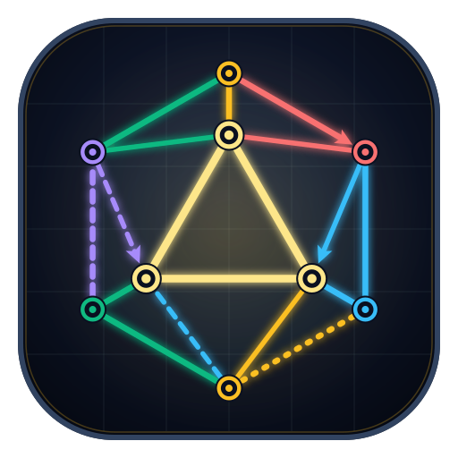

<p align="center">
  
</p>

<h1 align="center">Dice Chaos Connections</h1>

<p align="center">
  <strong>Offline TTRPG Campaign Mind-Map, Conspiracy Board &amp; Zero-Spoiler 2nd-Screen Player Display</strong>
</p>

<p align="center">
  <a href="https://github.com/dicechaos/DiceChaosConnections/releases/latest"></a>
  <a href="https://github.com/dicechaos/DiceChaosConnections/actions"></a>
  <a href="https://dicechaos.com"></a>
  <a href="https://github.com/dicechaos/DiceChaosDisplay"></a>
  <a href="https://github.com/dicechaos/DiceChaosMasters"></a>
  <a href="./LICENSE"></a>
</p>

---

**Dice Chaos Connections** is a local-first desktop studio built by **[Dice Chaos](https://dicechaos.com)** for Dungeon Masters, Game Masters, worldbuilders, and tabletop groups who love rolling real handcrafted polyhedral dice around the table. Map out NPCs, factions, territories, clues, secret plots, and edge-to-edge relationships on an infinite tactile canvas—then broadcast a **strictly sanitized, zero-spoiler 2nd-Screen Player Window** straight to your table TV, projector, or Discord/OBS stream in real time, with zero accounts, zero cloud lock-in, and zero subscriptions.

> **Part of the Dice Chaos Tabletop Suite:** Built side-by-side with **[Dice Chaos Display](https://github.com/dicechaos/DiceChaosDisplay)** (offline 4K/8K tabletop TV battlemap studio with feathered Fog of War & true 1-inch physical miniature calibration) and **[Dice Chaos Masters](https://github.com/dicechaos/DiceChaosMasters)** (free offline parametric 3D polyhedral dice master, matched insert blank & MSLA resin support CAD studio). Plan your world, NPCs, factions, and conspiracy webs in *Connections*, run tactical encounters right under your miniatures in *Display*, and forge your own custom sharp-edge resin dice masters in *Masters*—or equip your party at **[dicechaos.com](https://dicechaos.com)**. Found a bug or have a feature request? [Open an issue on GitHub](https://github.com/dicechaos/DiceChaosConnections/issues).

---

## Download & Install

1. Grab the latest installer (`dice-chaos-connections-1.0.0-setup.exe` or self-contained portable `dice-chaos-connections-1.0.0-win-x64-portable.zip`, plus macOS `.dmg` and Linux `.AppImage` / `.deb`) from **[GitHub Releases](https://github.com/dicechaos/DiceChaosConnections/releases/latest)**.
2. Launch **`DiceChaosConnections.exe`**—it opens out of the box with an interactive 36-node ***The Hobbit: Eve of Five Armies*** showcase campaign and an opt-in **5-Step Feature Tour** (`Tour` button in the top bar).

> **Windows SmartScreen / macOS Gatekeeper Note:** Because builds are not yet signed with a commercial EV certificate:
> - **Windows:** If *"Windows protected your PC"* appears on first launch, click **More info** -> **Run anyway**.
> - **macOS:** Right-click (or Control-click) the app -> **Open** on first launch.

---

## Key Features

### Tactile Mind-Map & Conspiracy Canvas
- **1-Step Creation:** Double-click empty canvas to spawn an entity, or drag any connection point into empty space to create and link a new card in one motion.
- **Customizable & Movable Connection Points:** Edit, slide (`Alt+Drag`), rename, restyle, or hide any of the **8 pre-populated connection points** (`Top`, `Right`, `Bottom`, `Left`, `TL`, `TR`, `BL`, `BR`)—or right-click any card or group border to add unlimited named connection points (*East Gate*, *Secret Postern*, etc.) with attached lines following automatically.
- **360° Endpoint Dragging & Point Visuals:** Drag either end of any selected connection line around any border (`5%–95%` with magnetic detents) or across to reconnect onto another entity/group; customize per-point **Shape** (*Diamond*, *Circle*, *Ring*, *Square*, *Edge Pill*, *Hidden*), **Size** (`S` / `M` / `L`), **Color** (*Match Border* auto-accent + swatches + custom hex), **Visibility** (*Hover*, *DM Studio*, or *Public Map* on the Player TV & exports), **Border Label Badges**, and **Apply Style to All Points**.
- **Configurable Drag Jump Distance & Grid Snap (`G`):** Choose `Free (1px)` or `4px`–`48px` drag snap steps from the top bar or canvas right-click menu, hold `Alt` mid-drag to invert snapping on the fly, and keep background grids automatically harmonized per theme.
- **Manual Card Resizing & Layer Stacking (`[` / `]`):** Drag corners/edges (`140×52 px` to `640×520 px`), batch-match dimensions across selected cards, and step overlapping cards *Forward*, *Backward*, *To Front* (`Ctrl+]`), or *To Back* (`Ctrl+[`) across a strict 5-band z-index pipeline so connection lines never sink behind group backgrounds.
- **7 Shapes, Custom Colors & 40 Status Icons:** Customize shapes (*Rounded*, *Box*, *Sticky*, *Pill*, *Leaf*, *Arch*, *Oval*), background colors with automatic WCAG light/dark text contrast, and 40 TTRPG status markers (`Skull`, `Crown`, `Flame`, `Swords`, `Lock`, etc.).
- **Edge-to-Edge ("Conspiracy") Links:** Connect entities *directly to another relationship pill* (e.g., linking an informant to a secret alliance line), with directional/bidirectional arrowheads (`→`, `←`, `↔`), draggable spline waypoints, and movable labels.

### Connectable Group Regions & Factions
- **True Connectable Containers (`Ctrl+G`):** Group cities, factions, dungeon wards, or army hosts with their own editable perimeter connection points, synchronized member + waypoint dragging, and position locking.
- **Rich Region Styling:** 7 tabletop region tints + custom hex colors & opacity (`8%–50%`), crest badges or top banners, status markers, and 1-click **Tidy Grid** / **Fit Bounds** / **Select All**.

### TTRPG Sheets, Portraits & `[[Wiki-Links]]`
- **Built-In + Custom Categories:** Ships with *PC*, *NPC*, *Location*, *Item*, *Organization*, and *Event*, plus unlimited custom categories mapped to 5 structured sheet archetypes (Party Standing, Ancestry, Class/Role, AC/HP, Voice Cue, Rarity, Attunement, Danger Tier, Quest Status, etc.).
- **3-Tier Notes:** Separate **Public Lore**, **DM Secret Notes** (never exposed to players), and collaborative **Party Notes**.
- **Self-Contained WebP Portraits:** Embedded directly inside your `.json` file (*Circular Token*, *Full-Bleed Card Banner*, or *Handout Only*) so campaigns stay single-file portable with zero broken image paths.
- **Obsidian-Style `[[Wiki-Links]]` & Backlinks:** Type `[[` in any note for live autocomplete supporting `[[Aliases]]` and `[[Target|Display Text]]`, automatic rename refactoring across the entire graph, and an automatic **Mentioned-In Backlinks** panel.

### Zero-Spoiler 2nd-Screen Player Window & Home Conspiracy Edition
- **Pop-Out Player Screen:** Dedicated secondary window for table TVs, projectors, or Discord/OBS screen-sharing. Hidden items, DM secrets, and non-public connection point labels are stripped *before* leaving the GM state.
- **Live Table Controls:** Pause/resume live sync while making secret edits, sync the players' camera to your view, pop up cinematic **Spotlight Cards**, or tease **`???` Mystery Portraits** with 1-click *Reveal True Identity*.
- **Two-Way Party Conspiracy Workflow:** Export a **Spoiler-Free Player Handout `.json`** for players to explore at home, add **Party Notes**, and pin **`Theory` Cards/Links**—then non-destructively **Merge Party Notes** back into your master DM file.

### Campaign Timeline ("Session Time Machine")
- **Session Checkpoints & Visual Diffs:** Save snapshots after each session, preview past sessions safely in read-only mode, compare any two checkpoints with `+ New`, `~ Changed` (field-by-field before/after diffs), and `Removed` highlights, or restore a checkpoint to live.

### Dossier Exports, Obsidian Vaults & High-DPI Posters
- Export in either **Player-Safe** or **Full DM** scope:
  - **Obsidian Vault Folder:** Markdown notes sorted by category with YAML frontmatter, native `[[Wiki-Links]]`, and extracted `assets/` art ready for Obsidian's Graph View.
  - **Markdown Compendium (`.md`)** & **Print-Styled Lorebook (`.pdf`)**.
  - **High-DPI Map Poster (`.png`):** Auto-fitted full map or current screen at `1×`–`3×` resolution with optional theme-matched Title & Legend stamps—ready for printing or loading straight onto your tabletop TV in **[Dice Chaos Display](https://github.com/dicechaos/DiceChaosDisplay)**.

### 4 Tabletop Themes & Local-First Reliability
- Switch canvas themes per campaign (**Modern Studio**, **Dark Arcane**, **Parchment & Ink**, **Detective Corkboard**) alongside Light/Dark UI chrome.
- **Smart Toggleable Auto-Save:** Crash-safe atomic file writes, toggleable **Auto-Save** switch in the header & `Ctrl+K`, instant `Ctrl+S` (`Save`), and `Ctrl+Shift+S` (`Save As…`).

---

## Quick Shortcuts

| Shortcut / Gesture | Action |
| :--- | :--- |
| **Double-Click Empty Canvas** | Create new entity at cursor |
| **Drag Connection Point to Empty Space** | Quick-create & auto-connect new entity |
| **Right-Click Point · `Alt+Drag` Point** | Style, rename, reset, or slide any connection point (attached lines follow) |
| **Drag Selected Line Endpoint** | Slide endpoint 360° around any border or reconnect to another card/group |
| **`G` (or Hold `Alt` while dragging)** | Toggle Drag Grid Snap (`Free`–`48px`) / Temporarily invert snap |
| **Drag Card Corner / Edge** | Resize selected unlocked entity card (`W × H`) |
| **`Ctrl+G` / `Ctrl+Shift+G`** | Group selected entities / Ungroup (keeping entities) |
| **`[` / `]` · `Ctrl+[` / `Ctrl+]`** | Step Backward / Forward · Send to Back / Bring to Front |
| **`[[` inside Lore / Notes** | Autocomplete clickable `[[Entity]]` or `[[Entity\|Text]]` wiki-link |
| **`Ctrl+K` / `Ctrl+F`** | Open unified Search, `#Tags` & Command Palette |
| **`Alt+1` … `Alt+9`** | Fly camera to saved View Bookmark `1`–`9` |
| **`M`** | Toggle corner MiniMap radar |
| **`Ctrl+S` / `Ctrl+Shift+S`** | Save active `.json` / Save Campaign As new `.json` |
| **`Ctrl+Z` / `Ctrl+Y`** | Undo / Redo (50 steps) |
| **`Ctrl+C` / `Ctrl+V` / `Ctrl+D`** | Copy, Paste, or Duplicate selection with internal links |
| **`?`** | Open Studio Shortcuts, Tour & Starter Demo loader |

---

## Development & Building From Source

Requires **Node.js 20+** and **npm**.

```bash
# Install dependencies
npm install

# Start hot-reloading Electron + Vite dev studio
npm run dev

# Run TypeScript checks & production bundle
npm run build

# Package OS installers (outputs to dist/)
npm run build:win     # Windows (.exe NSIS installer & portable .zip)
npm run build:mac     # macOS (.dmg)
npm run build:linux   # Linux (.AppImage, .deb)
```

---

## Links & Feedback

- **Handmade Dice & Tabletop Gear:** [dicechaos.com](https://dicechaos.com)
- **Companion 4K/8K TV Battlemap Studio:** [Dice Chaos Display](https://github.com/dicechaos/DiceChaosDisplay)
- **Companion 3D Dice Master CAD Studio:** [Dice Chaos Masters](https://github.com/dicechaos/DiceChaosMasters)
- **Bug Reports & Feature Requests:** [GitHub Issues](https://github.com/dicechaos/DiceChaosConnections/issues)
- **License:** MIT License — Copyright © 2026 dicechaos (Gus). See [LICENSE](./LICENSE).
